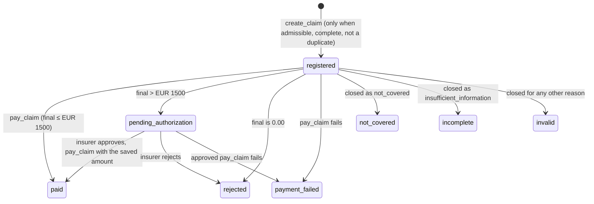

# What we changed in the harness

Team 1 · Eurapco hackathon · 28 Oct 2026

For each task in the brief: what the starter kit gave us, what we built on top of it, and what is still open.
Status reflects the code on the branches below, not a scored evaluation run.

| Branch | Content |
|---|---|
| `main` | Core harness: workflow, rules, write gate |
| `fix/response-schema` | Agent answers no longer rejected for a copied `$schema` key |
| `feature/minimum-information` | Minimum-information matrix in code (includes the fix above) |

## Status by task

| # | Task | Status | Main change |
|---|---|---|---|
| 1 | [Router and classification](#1-router-and-classification) | 🟡 Partial | Single routing entry point and agent-to-agent handover; decision model not wired yet |
| 2 | [Minimum information, asked once](#2-minimum-information-asked-once) | ✅ Done | Matrix, invoice parser and generated question in code |
| 3 | [Workflow state and stop/resume](#3-workflow-state-and-stopresume) | ✅ Done | Per-ticket workflow file; replies resume the same run and log |
| 4 | [Admissibility, authority, proposal integrity](#4-admissibility-authority-and-proposal-integrity) | ✅ Done | Every write goes through a rule gate; approval runs the exact saved proposal |
| 5 | [Calculation and duplicate prevention](#5-calculation-and-duplicate-prevention) | ✅ Done | Deterministic formula and duplicate key in code, covered by 34 tests |
| 6 | [Reimbursement-record lifecycle](#6-reimbursement-record-lifecycle) | ✅ Done | Every record ends in its actual outcome; state diagram and 20 tests |
| 7 | [Skills per agent](#7-skills-per-agent) | ✅ Done | Six skills, one per operation, loaded by category |
| 8 | [Logger integration](#8-logger-integration) | ✅ Done | Routing, status, human rounds, resumes, blocks and gaps all logged |
| 9 | [Actual results, working enquiries](#9-actual-results-and-working-enquiries) | 🟡 Partial | Claimed effects must be backed by tool results; full ticket run pending |

---

## 1. Router and classification

> Improve the router and classification, and organize your harness around the common scope.

**Starter kit:** one regular expression. Any of "claim", "invoice", "reimburse" sends the request to Claims, everything else to Administration. The agent's model then picks the category on its own.

**What we did**
- `pick_agent()` is now the only place that calls the router. It accepts a plain agent name or a full decision object, so the decision model (Jev) can be plugged in without touching the rest of the runtime.
- If an agent classifies the request as belonging to the other agent (`out_of_scope_claims` / `out_of_scope_administration`), the harness hands it over once, before any effect, and logs the handover and the new routing.
- The returned category is checked against the vocabulary of the handling agent; an invalid one goes back to the model with feedback.
- All requests follow one common path: route, gather facts, check rules, ask or propose, execute, record, answer.

**Files:** `app/runtime.py`, `app/router.py`

**Still open:** replace the regex with Jev. Send the context (request text plus whether an invoice, prescription or claim ID is attached), the routing question and the agent descriptions; validate the answer in code, fall back to simple rules if Jev fails, and log who decided.

## 2. Minimum information, asked once

> Use the minimum-information matrix to collect genuinely missing information once.

**Starter kit:** prompt instructions only. Nothing stopped a second question, an incomplete question, or a question about information the tools already provide.

**What we did**
- **One round, enforced:** a second question is turned into `insufficient_information`; an `unclear` request closes without asking.
- **Matrix in code** (`app/minimum_info.py`): a parser reads the eight invoice items (provider ID, invoice number, invoice date, service date, patient, service, EUR amount, paid status) without a model.
- A prescription must name the same patient as the invoice and a matching service; non-empty text is not enough.
- **The question is generated in code** and lists every gap at once, nothing more.
- The agent cannot ask when nothing is missing, cannot ask for documents for an excluded service (dental, T14), and cannot close as insufficient before asking.
- `create_claim` is blocked while information is missing or when its values differ from the invoice text.
- Contact values must appear in the request or the reply: in T04 the agent cannot invent the postal code.
- A reply can add facts but never replace the original ones; a conflict is recorded in the log.

**Files:** `app/minimum_info.py`, `app/workflow.py`, `app/rules.py`, `tests/test_minimum_info.py`

**Still open:** code checks for coverage changes (target value given) and claim enquiries (record identifiable). A model fallback for invoices whose labels the parser does not recognise.

## 3. Workflow state and stop/resume

> Implement workflow state, correlation and stop/resume for human replies. Keep the same domain run and original facts; never restart a reply as a new request.

**Starter kit:** the runtime handled the first message only. The command line rejected every reply event.

**What we did**
- `app/workflow.py` saves one file per ticket with the run ID, log path, agent, category, facts, conversation, proposal, applied effects and format errors.
- `python -m app run` now accepts `clarification_reply` and `insurer_decision`: it finds the ticket's workflow, reuses the **same run ID** and reloads the existing log.
- A reply is admitted only if the ticket is waiting for that kind of reply; a second copy of the same reply is refused.
- Insurer decisions are handled without the model: approve runs the saved proposal, reject closes the request.

**Files:** `app/workflow.py`, `app/runtime.py`, `app/__main__.py`

**Still open:** re-running a ticket replaces its workflow, so a reply applies to the latest run. An explicit table of allowed state transitions would make the rules visible.

## 4. Admissibility, authority and proposal integrity

> Enforce admissibility, active-policy and date checks, authority and proposal integrity.

**Starter kit:** business rules lived in the prompts. The tools validate formats but do not decide what is allowed.

**What we did**
- **Write gate:** every write tool call passes through `rules.check_tool_call()` before it reaches the domain.
- Only the ticket's own policy can change; the policy must be active; excluded services, uninsured patients and service dates outside cover (both ends included) are refused.
- Coverage decreases are refused; a final annual limit above 5000 or deductible above 200 needs the insurer; termination always does; payments above EUR 1500 do.
- After approval only the exact saved proposal can run: same tool, same arguments.
- A write that already succeeded is never repeated; the earlier result is returned instead.
- Proposals are checked for shape and arguments, and refused when no authorization is actually needed.

**Files:** `app/rules.py`, `app/runtime.py`

**Still open:** rule identifiers in every refusal reason, and a hash of the saved proposal checked at approval.

## 5. Calculation and duplicate prevention

> Implement deterministic Claims calculation and duplicate prevention.

**Starter kit:** the formula and duplicate key were described in the prompt; the model did the arithmetic.

**What we did**
- `calculate_reimbursement()`: max(0, expense − deductible) × 80 %, rounded half-up to cents with `Decimal`, capped by the remaining limit, plus the authorization flag (strictly above EUR 1500).
- `find_duplicate()`: provider ID + invoice number + invoice-date year, against paid or pending records. Pending includes `payment_failed`, because such a record can still be paid; a second record could lead to a double payment.
- Both are offered to the Claims agent as local tools, so it never calculates by itself.
- `pay_claim` is refused unless the amount equals the calculated one, is never sent for 0.00, needs the exact approved proposal above EUR 1500, and only applies to a record created in the same request.
- `tests/test_calculation.py` (34 tests, no model):
  - the policy examples: 180 → 104.00, 1925 → 1500.00 (autonomous), 2000 → 1560.00 (insurer), 2000 with 900 remaining → 900.00 (autonomous);
  - deductible floor, rounding to cents, strict threshold (1500.02 needs the insurer), current deductible after a coverage change, no remaining limit;
  - invariants over about 13,000 amounts: never negative, never above the remaining limit or 80 % of the expense, always two decimals;
  - each part of the duplicate key, and which record statuses block;
  - the gates: duplicate registration refused (T13 → CL-H001), wrong amount, zero payment, approval above the threshold, capped payment.

**Files:** `app/rules.py`, `app/runtime.py`, `tests/test_calculation.py`

**Still open:** nothing for this task.

## 6. Reimbursement-record lifecycle

> When to register a record, how to update outcomes, when a workflow ends without a new record.

| Situation | Record | Tool sequence | Outcome |
|---|---|---|---|
| Excluded, inactive, not insured, outside cover, duplicate, information missing | None | — | `closed_without_execution` |
| Admissible, final ≤ EUR 1500 | Created | `create_claim` → `pay_claim` | `paid` |
| Admissible, final > EUR 1500 | Created, pending | `create_claim` → `record_claim_outcome(pending_authorization)` | `awaiting_authorization` |
| … insurer approves | Paid | `pay_claim` with the saved amount | `paid` |
| … insurer rejects | Rejected | `record_claim_outcome(rejected)` | `insurer_rejected` |
| Final reimbursement 0.00 | Rejected | `create_claim` → `record_claim_outcome(rejected)` | `zero_reimbursement` |
| Payment attempted and failed | Payment failed | `pay_claim` fails → `record_claim_outcome(payment_failed)` | `technical_failure` |

**Design decisions**
- **No record before the request is admissible.** Exclusions, inactive policies, uninsured patients, dates outside cover, duplicates and missing information close without a record, so history only holds real reimbursement attempts.
- **The record is created before asking the insurer.** The proposal then names an existing `claim_id`, and the pending record blocks a duplicate registration while the insurer decides.
- **No record stays open when a request ends.** When the request closes, the harness stores the actual outcome on any record it created that is still `registered` or `pending_authorization`. The model never has to remember it. Zero reimbursement is recorded as `rejected`.
- **A failed payment is recorded as `payment_failed`.** Such a record can still be paid later, so it also counts as pending for duplicates.
- **Handover keeps the record open.** After a technical failure or handover without a payment attempt, the record stays `registered` for the colleague who takes over, and keeps blocking a duplicate.

**What we did**
- `rules.closing_record_outcome()`: one pure function maps the request outcome to the record outcome (table above).
- `Session.close_records()` applies it when every request ends, through the same write gate as any other call.
- Real `pay_claim` failures are tracked per record, so a failed approved payment ends as `payment_failed` instead of staying `pending_authorization`.
- The Claims prompt no longer asks the model to record outcomes itself.
- `tests/test_claim_lifecycle.py` (20 tests, no model): the mapping, and complete paths on a real domain store with a fake client: zero reimbursement, orphan record, pending while waiting, approve → paid with the remaining limit updated, reject → rejected without payment, failed approved payment → `payment_failed`, handover, valid log.

**Files:** `app/rules.py`, `app/runtime.py`, `agents/claims/prompt.md`, `tests/test_claim_lifecycle.py`

**Still open:** nothing for this task.

## 7. Skills per agent

> Write and use at least one meaningful skill per agent.

**Starter kit:** a loader in `app/skills.py` that nothing called, and empty skill folders.

**What we did**
- **Six skills, one per supported operation:**

  | Agent | Skill | What it adds beyond the policy text |
  |---|---|---|
  | Claims | `reimbursement-request` | Service-to-category table, the order of checks, exact create_claim values, how to explain the amount |
  | Claims | `claim-enquiry` | How to find the record without an ID, what to say for each record status |
  | Administration | `policy-enquiry` | Which policy field answers which question; "how do I terminate?" stays an enquiry |
  | Administration | `contact-update` | Exact value formats, ask only for the missing address parts |
  | Administration | `coverage-change` | Threshold table for the final values, one proposal for a combined change |
  | Administration | `policy-termination` | Always a proposal, never a direct call; already terminated means no_change |

- **Each skill says what the harness will refuse,** so the agent does not try a call that will be blocked. That saves turns.
- **Loaded by category:** `select_skills(agent, category)` reads each skill's frontmatter and returns only the skill for the request's category. Before the category is known, or when none covers it (a request handed over from the other agent), the agent gets all of its skills. Once the router sets the category, only that skill is sent: the Administration prompt for a coverage change drops from about 12,600 to 8,100 characters.
- **Procedures moved out of the prompts:** the prompts keep the general rules; each operation's procedure lives only in its skill.
- `tests/test_skills.py` (9 tests): valid frontmatter, required sections, every supported operation has a skill, selection by category, the template is not loaded, the prompt carries the skill without its frontmatter.

**Files:** `skills/claims/*.md`, `skills/administration/*.md`, `skills/README.md`, `app/skills.py`, `app/runtime.py`, `agents/*/prompt.md`, `tests/test_skills.py`

**Still open:** run the training tickets with the model to compare turns and outcomes with the previous prompts. The router team sets `wf["category"]` so that only one skill is loaded from the first turn.

## 8. Logger integration

> Connect your workflow, classification and human events to the supplied logger.

**Starter kit:** the logger existed and recorded the first message, tool calls and the final answer.

**What we did**
- Routing, every status change with its category, clarification and authorization requests, and each resumed reply are logged; a domain snapshot is saved after every event.
- Refused tool calls are logged with `harness_blocked`, refused repeats as errors, and a format-error handover includes a report of every attempt.
- The clarification request records exactly which items were missing; a reply that contradicts the original facts is noted in the status reason.
- A test checks that every event kind the runtime writes exists in the log schema, after an unknown kind made a T09 run fail.

**Files:** `app/runtime.py`, `app/__main__.py`, `tests/test_minimum_info.py`

**Still open:** log the router's decision (who decided and why) once Jev is connected.

## 9. Actual results and working enquiries

> Communicate actual results, not intended effects, and keep the enquiries working.

**Starter kit:** the model's own answer was logged as the result, whatever the tools had actually done.

**What we did**
- An answer saying `paid`, `updated` or `terminated` is refused unless a successful tool result in this request backs it.
- The agent state is derived from the outcome, so the two can no longer contradict each other.
- After an insurer decision the customer message is built from the tool data: amount, payment ID, values before and after.
- A rejected answer now tells the model what was wrong. Before this fix T04 failed after eleven identical rejections caused by a copied `$schema` key.

**Files:** `app/workflow.py`, `app/runtime.py`

**Still open:** run T01–T15 with their replies and compare each message with the domain snapshot. Use templates for messages on paths without an insurer decision.

---

**Tests:** 139 of 141 pass, including 25 minimum-information, 34 calculation, 20 record-lifecycle and 9 skill tests that need no model. The two failures come from the starter kit: one test still expects replies to be rejected, the other compares a path with Windows separators.
